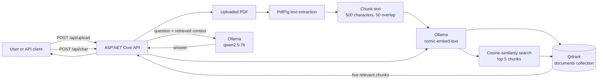

# Ollama RAG POC (.NET)

A local Retrieval-Augmented Generation (RAG) proof of concept built with ASP.NET Core, Ollama, and Qdrant. Upload a PDF, ask a question about it, and the API retrieves the most relevant passages before asking a local language model to answer.

## What is RAG?

Large language models can produce useful answers, but they do not automatically know the content of your private or recently created documents. **RAG** supplies relevant document text at question time:

1. **Indexing:** Extract document text, split it into small chunks, turn each chunk into an embedding (a numeric representation of its meaning), and store it in a vector database.
2. **Retrieval:** Turn a user's question into an embedding and find the semantically nearest document chunks.
3. **Generation:** Provide those chunks as context to a language model, which produces an answer grounded in the retrieved content.

This avoids retraining the model for each document and lets the knowledge base grow by indexing additional files.

## Architecture and flow



## Prerequisites

- [.NET 10 SDK](https://dotnet.microsoft.com/download)
- [Ollama](https://ollama.com/) running at `http://localhost:11434`
- [Qdrant](https://qdrant.tech/) running with gRPC available at `localhost:6334`
- Ollama models used by this POC:

  ```powershell
  ollama pull nomic-embed-text
  ollama pull qwen2.5:7b
  ```

Start Ollama if it is not already running:

```powershell
ollama serve
```

Start Qdrant separately before starting the API. For example, using Docker:

```powershell
docker run --rm -p 6333:6333 -p 6334:6334 qdrant/qdrant
```

## Run the POC

1. Restore packages and start the API:

   ```powershell
   dotnet run --project .\src\OllamRagPOC\OllamRagPOC.csproj
   ```

2. Open Swagger at `http://localhost:5016/swagger` when running with the default HTTP launch profile.

3. Index a PDF using `POST /api/upload`. The request must use `multipart/form-data` with its file field named `file`.

   ```powershell
   curl.exe -X POST "http://localhost:5016/api/upload" `
     -F "file=@C:\path\to\document.pdf"
   ```

   A successful response is `Document Indexed`.

4. Ask a question using `POST /api/chat` with a JSON body containing `question`.

   ```powershell
   curl.exe -X POST "http://localhost:5016/api/chat" `
     -H "Content-Type: application/json" `
     -d "{\"question\":\"What are the main points of the document?\"}"
   ```

   The response body is the model's plain-text answer.

## How the POC works step by step

### 1. Application startup

`Program.cs` registers the controllers and services, configures HTTP clients for Ollama, and ensures the Qdrant `documents` collection exists. The collection stores 768-dimensional vectors and uses cosine distance.

### 2. Document indexing (`POST /api/upload`)

1. The API writes the uploaded file to the system temporary directory.
2. `PdfService` uses PdfPig to extract text from every PDF page.
3. `ChunkingService` creates 500-character chunks with 50 characters of overlap. Overlap helps retain meaning across chunk boundaries.
4. For each chunk, `OllamaEmbeddingService` calls Ollama's `/api/embeddings` endpoint with `nomic-embed-text`.
5. `QdrantService` stores the resulting vector in the `documents` collection with the original chunk in its `content` payload.

### 3. Question answering (`POST /api/chat`)

1. The API embeds the submitted question using the same embedding model.
2. Qdrant performs a cosine-similarity search and returns the five closest chunks.
3. The API joins those chunks into a context block.
4. `OllamaChatService` sends the context and question to Ollama's `/api/generate` endpoint using `qwen2.5:7b`.
5. The prompt instructs the model to answer only from the supplied context, and the API returns its generated text.

## Configuration

The defaults are in `src\OllamRagPOC\appsettings.json`:

```json
{
  "Ollama": {
    "BaseUrl": "http://localhost:11434",
    "ChatModel": "qwen2.5:7b",
    "EmbeddingModel": "nomic-embed-text"
  },
  "Qdrant": {
    "Host": "localhost",
    "GrpcPort": 6334
  }
}
```

`Ollama:BaseUrl`, `Qdrant:Host`, and `Qdrant:GrpcPort` are read by the application. The embedding and chat model names are currently hard-coded in their respective services, so if you change models, update `OllamaEmbeddingService.cs` and `OllamaChatService.cs` too. The embedding model must produce 768-dimensional vectors unless the Qdrant collection configuration is changed to match.

## Current POC boundaries

- It accepts PDF uploads only.
- All indexed chunks share one `documents` collection; there is no document identifier, isolation, deletion endpoint, or duplicate detection.
- Uploaded files are placed in the system temporary directory and are not removed by the current implementation.
- Retrieval always returns up to five chunks; there is no relevance-score threshold or source citation in the response.
